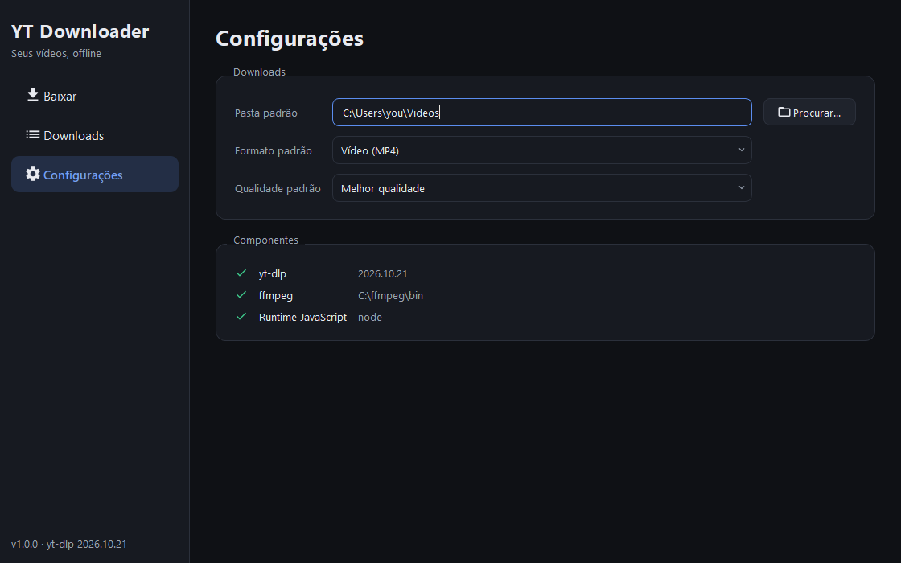

# Media Suite — YT Downloader + LocalFlix + MagnifyFactory

Os três aplicativos agora estão integrados em uma janela Windows, com o tema
escuro do YT Downloader e do LocalFlix: biblioteca, player, downloads, conversão
e edição. Vídeos baixados podem ser adicionados automaticamente à biblioteca
ou enviados ao conversor.

Os downloads aceitam links do YouTube, Google Drive e outras fontes compatíveis
com yt-dlp, além de arquivos diretos e streams HLS/DASH sem DRM. Há suporte a
arquivo de cookies para conteúdos que exigem acesso.

Abra **`dist/MediaSuite-1.1.0/MediaSuite.exe`** (ou `run.cmd`). Para gerar o aplicativo
e o ZIP portátil, execute `build.cmd`. Requisitos e detalhes da integração:
[suite/README.md](suite/README.md).

Os fontes dos três aplicativos estão neste repositório. As pastas de origem
LocalFlix e MagnifyFactory não foram alteradas. A biblioteca do Media Suite
fica em `%APPDATA%\MediaSuite`; os dados anteriores permanecem preservados.

---

## YT Downloader original

A small Windows desktop app for downloading YouTube videos and audio. Paste a link, pick **MP4 or MP3** and a
quality, and it downloads in the background with real progress, speed and time left. Whole playlists work too.
Built on [yt-dlp](https://github.com/yt-dlp/yt-dlp), with the look of
[LocalFlix](https://github.com/victorhmrod/LocalFlix).

* **Preview before downloading:** thumbnail, title, channel, length and views, and only the resolutions that video
  actually has.
* **MP4 video** up to the best quality available (4K included), or **MP3 audio** at 192 kbps.
* **Playlists:** download a whole playlist into its own folder, with numbered files.
* **A downloads list:** up to 3 at a time, with cancel, retry, *open file* and *show in folder*.
* **Remembers your defaults:** download folder, format and quality.
* No account and no telemetry. The interface is in Brazilian Portuguese.




*Screenshots show [Big Buck Bunny](https://peach.blender.org/), © Blender Foundation, licensed under
[CC BY 3.0](https://creativecommons.org/licenses/by/3.0/).*

## Install

Download **`YTDownloader-<version>-setup.exe`** from the
[latest release](https://github.com/victorhmrod/yt-downloader/releases/latest) and run it.
* It installs for your user account by default, so no administrator rights are needed. Pick *install for all users*
  in the dialog if you prefer that.
* It adds a Start Menu entry, plus an optional desktop icon.
* It registers the app in *Settings → Apps*, so you can uninstall it from there.
* The installer is in English and Brazilian Portuguese.
* Uninstalling removes the program and asks whether to also delete your settings. Downloaded files are never touched.

Prefer no installer? The release also has **`YTDownloader-<version>-portable.exe`**, a single file you can run from
anywhere. It starts a few seconds slower because it unpacks itself every time.

The installer and the portable exe are not code-signed, so Windows SmartScreen may show *"Windows protected your
PC"*. Choose *More info → Run anyway*. If you want to be sure, check the download against `SHA256SUMS.txt`:

```bat
certutil -hashfile YTDownloader-1.0.0-setup.exe SHA256
```

### Recommended: FFmpeg and Node.js

YT Downloader runs without them, but works much better with them. It finds both on your `PATH` automatically, and
the *Configurações* (Settings) page shows what it detected.

| Tool | What it adds | Install |
|------|--------------|---------|
| [FFmpeg](https://ffmpeg.org/) | MP3 conversion. Video above 720p: YouTube serves high resolutions as separate video and audio streams, and FFmpeg merges them | `winget install Gyan.FFmpeg`, or drop `ffmpeg.exe` next to `YT Downloader.exe` |
| [Node.js](https://nodejs.org/) or [Deno](https://deno.com/) | YouTube now requires a JavaScript runtime to unlock all formats. Without one, some formats may be missing | `winget install OpenJS.NodeJS.LTS` |

Without FFmpeg, video downloads fall back to the best single-file MP4, which is usually 360p or 720p.

## Use

1. Copy a YouTube link and press **Colar** (Paste), or paste it into the box and press **Buscar** (Search).
2. Choose **Formato** (format: MP4 video or MP3 audio), **Qualidade** (quality) and where to save it. If the link is
   part of a playlist, tick *Baixar a playlist inteira* to get the whole playlist.
3. Press **Baixar** (Download). The download shows up in the **Downloads** list, where you can follow it, cancel it,
   or open the file when it finishes.

Video files are named after the video title. Playlists go into a folder named after the playlist, with files named
`001 - Title.mp4`, `002 - Title.mp4` and so on.

Only download videos you have the right to download. YouTube's Terms of Service restrict downloading content
without permission from YouTube or the rights holder.

## When downloads stop working

YouTube changes often, and yt-dlp ships fixes just as often. Every release of YT Downloader bundles the yt-dlp
version shown in the sidebar. If downloads start failing, install the newest release. If none is out yet, you can
rebuild the app from source (see below), which picks up the latest yt-dlp automatically.

## Build from source

Requirements:
* Windows 10/11 x64
* Python 3.12 or newer
* [Inno Setup 6](https://jrsoftware.org/isinfo.php), only needed for the installer: `winget install JRSoftware.InnoSetup`

```bat
git clone https://github.com/victorhmrod/yt-downloader.git
cd yt-downloader
pip install -r requirements.txt
python yt_downloader.py        :: run from source
scripts\make-release.cmd       :: build every release asset into dist\ and test them
```

`scripts\make-release.cmd` (or `build.cmd`, which calls it) does all of this in one go:

1. Installs the build dependencies and generates the icon (`tools\make_icon.py`).
2. Builds with PyInstaller twice: as a folder for the installer, so the app starts fast, and as a one-file portable exe.
3. Compiles the installer from `installer\YTDownloader.iss` and writes `SHA256SUMS.txt`.
4. Runs a smoke test on the portable exe.
5. Tests the installer for real: a silent per-user install into a temporary folder, a launch of the installed copy,
   and a silent uninstall that must remove both the files and the *Apps* entry.

Options: `-SkipDeps` skips pip, and `-SkipTest` skips the tests.

The output in `dist\`:

| File | What it is |
|------|------------|
| `YTDownloader-<version>-setup.exe` | Windows installer |
| `YTDownloader-<version>-portable.exe` | single-file executable |
| `SHA256SUMS.txt` | checksums of both |

The version number lives in one place: `APP_VERSION` in `yt_downloader.py`.

## How it works

Everything is in `yt_downloader.py`:

* **Interface:** PySide6 (Qt 6 Widgets), using the LocalFlix theme: Fusion style, the same colour palette and
  stylesheet, Material icons and a dark title bar.
* **Searching a link:** yt-dlp runs on a background thread with `extract_flat` turned on, so even long playlists
  load quickly.
* **Each download** is a `DownloadJob`, which runs `yt_dlp.YoutubeDL` on its own thread. A semaphore allows 3
  downloads at a time. Progress and post-processing hooks send Qt signals back to the interface. When you cancel,
  the next hook raises an exception, which stops the download cleanly.
* **Settings** are stored with `QSettings` (`HKCU\Software\YTDownloader`).

## License

[GNU Affero General Public License v3.0](LICENSE). Third-party components and their licences are listed in
[THIRD_PARTY_NOTICES.md](THIRD_PARTY_NOTICES.md).
