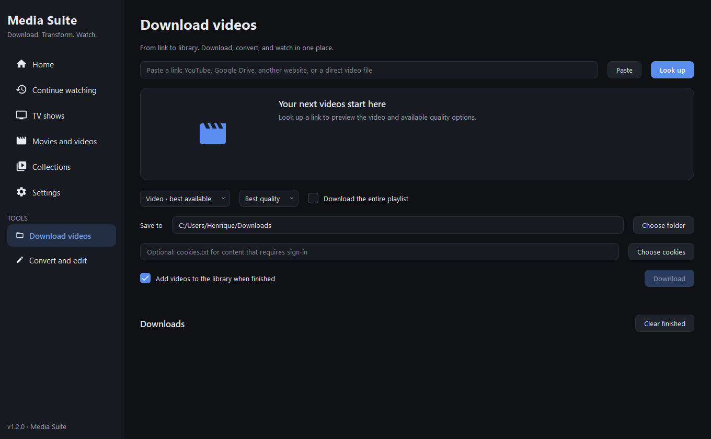
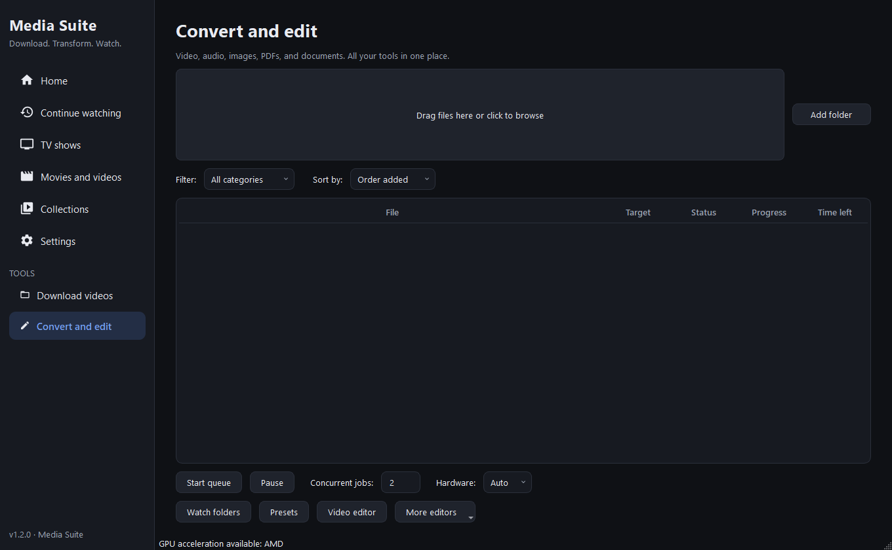

# Media Suite

A Windows desktop app that brings **YT Downloader**, **LocalFlix**, and
**MagnifyFactory** together in one window, using the shared LocalFlix dark theme.
Download media, organize your offline library, watch videos, and convert or edit
files without switching applications. The interface and documentation are in English.

## Download and install

Get the Windows x64 installer from the
[latest release](https://github.com/victorhmrod/MediaSuite/releases/latest):

- **MediaSuite-1.2.0-setup.exe** installs for your user account by default, adds a
  Start Menu shortcut, and supports uninstalling from Windows Settings.
- **MediaSuite-1.2.0-win64.zip** is portable: extract it and run `MediaSuite.exe`.
- **SHA256SUMS.txt** contains checksums for both downloads.

Python and Qt are bundled. FFmpeg and FFprobe are included in the published
package. Some websites need Node.js or Deno on PATH. PDF, document, archive, and
3D tools may require additional programs; see [the guide](suite/README.md).

## Features

- **Download videos:** YouTube, Google Drive, other yt-dlp-supported websites,
  direct media links, embedded videos, and non-DRM HLS/DASH streams. Preview
  available quality options, download playlists, extract MP3 audio, cancel or
  retry jobs, and run up to three downloads at once.
- **Optional authentication:** select a Netscape-format cookies file from an
  account with access. Support depends on the website and its access controls.
- **Library and playback:** shows, movies, collections, manual episode ordering,
  playback progress, Continue Watching, automatic next episodes, chapter skips,
  and picture in picture.
- **Convert and edit:** video, audio, images, PDFs, documents, archives, and 3D
  models, with presets, watch folders, and the MagnifyFactory editors.
- **Connected workflow:** add completed video downloads to your library
  automatically, send a download to the converter, or add a converted video to
  the library from its context menu.





The library is stored in `%APPDATA%\MediaSuite`. Media files remain in their
original locations. The legacy LocalFlix library is separate; see the guide for
using an existing data folder.

## Build from source

Requirements: Windows 10/11 x64, Visual Studio with Desktop development with C++,
Ninja, CMake 3.24+, Qt 6.7+ for MSVC, Python, and 7-Zip. Inno Setup 6 is required
for the installer.

```powershell
git clone https://github.com/victorhmrod/MediaSuite.git
cd MediaSuite
python -m pip install 'yt-dlp[default]' pyinstaller
.\scripts\fetch-suite-deps.ps1
$env:LOCALFLIX_QT_DIR = 'D:\Qt\6.7.3\msvc2019_64'
.\scripts\build-suite.cmd
```

Build the installer, portable ZIP, and checksums, then test the installer:

```powershell
.\build.cmd
```

Run the test suites:

```powershell
ctest --test-dir build/suite --output-on-failure
python -m unittest discover -s suite/tests -p test_worker.py -v
```

See [suite/README.md](suite/README.md) for configuration, optional dependencies,
data locations, packaging, and test details. The original Python downloader is
retained in `yt_downloader.py`; the integrated native application is built by
CMake. LocalFlix and MagnifyFactory sources are included under `suite/vendor`.

## License

[AGPL-3.0](LICENSE). Upstream component licenses are preserved in `suite/vendor`.
See [THIRD_PARTY_NOTICES.md](THIRD_PARTY_NOTICES.md).
